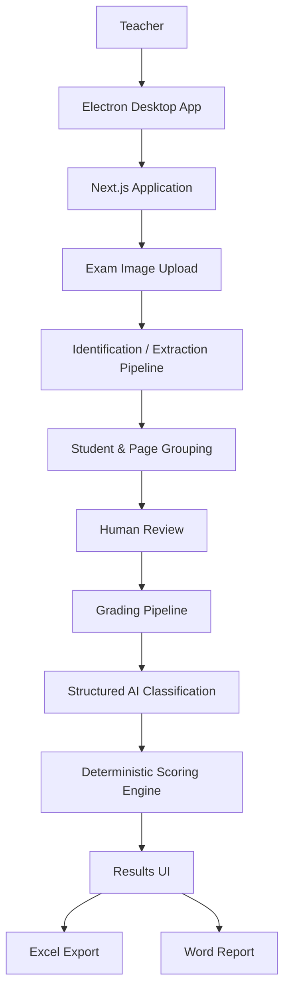
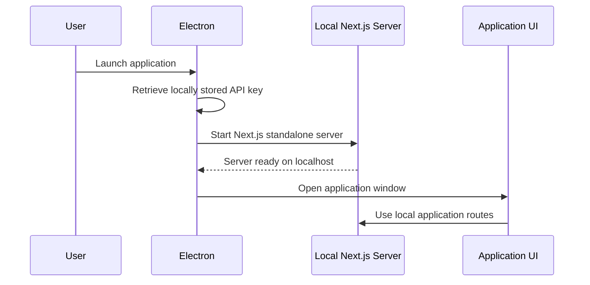
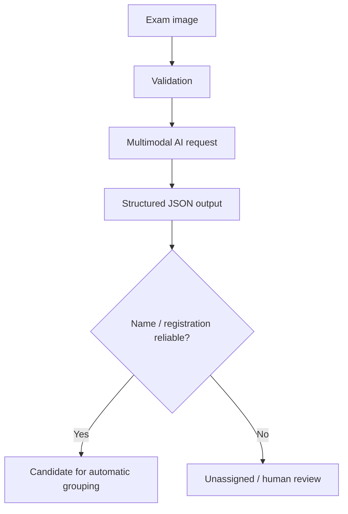
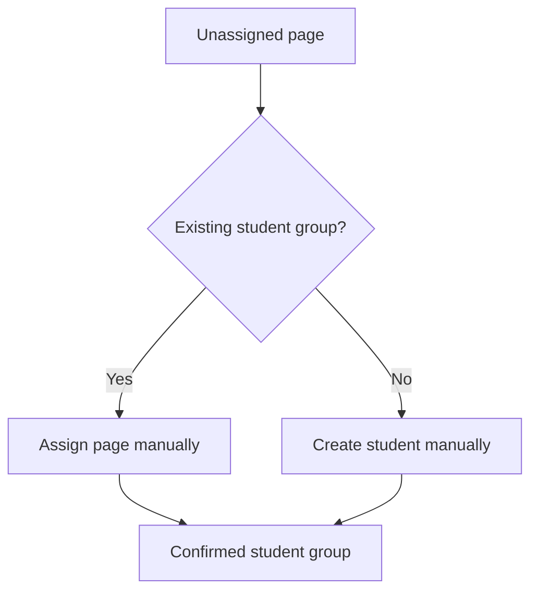
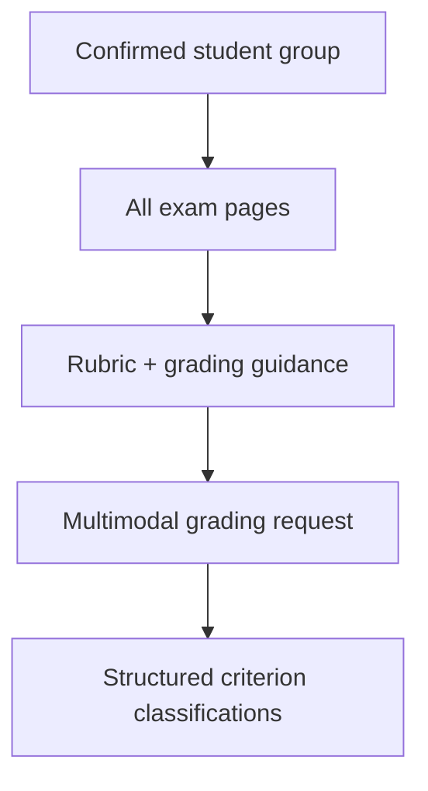
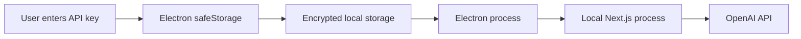
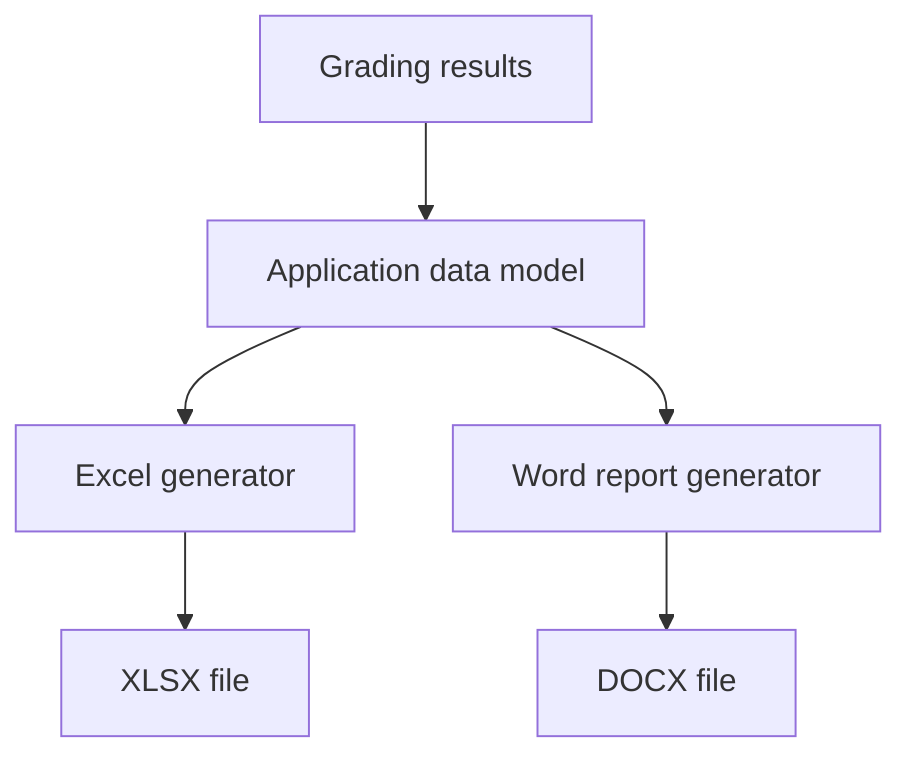
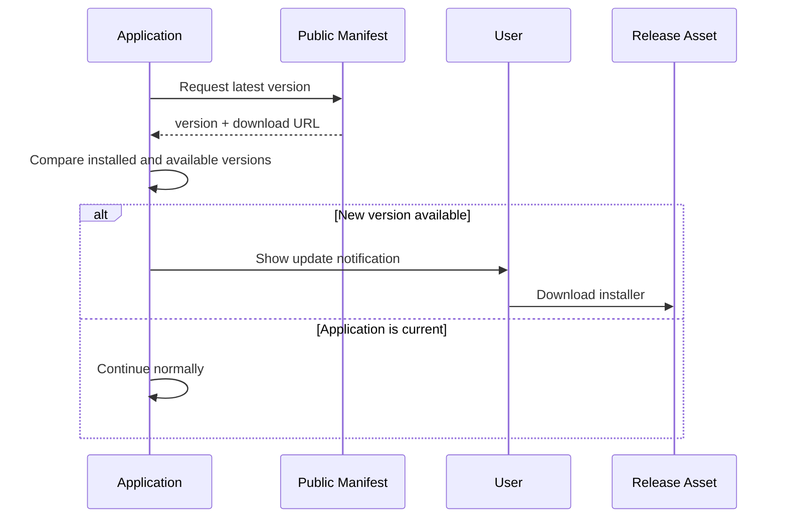
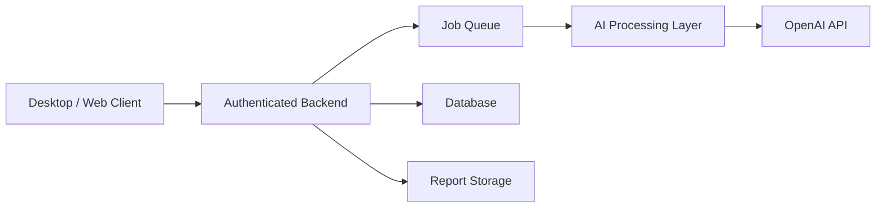

# Architecture

This document describes the technical architecture of **Corretor de Provas**, a desktop application for AI-assisted grading of handwritten academic exams.

The system was designed around three main principles:

1. **AI assists interpretation, but does not own the final scoring logic**
2. **Humans remain in control of uncertain or high-impact decisions**
3. **Desktop distribution should remain simple for non-technical users**

---

## 1. High-Level Architecture

The application combines a Next.js application with an Electron desktop shell.



The AI layer is responsible for interpreting images and classifying rubric criteria.

The application itself remains responsible for workflow state, grouping, validation and numerical score calculation.

---

## 2. Runtime Architecture

The desktop application is distributed using Electron.

When the packaged application starts:



Electron acts as the desktop host while the Next.js standalone application provides both the interface and local API routes.

The application does not require a remote application server for its own business logic.

---

## 3. Main Processing Pipeline

The grading workflow is divided into separate stages instead of sending every task to the AI in a single request.


This separation makes the workflow easier to inspect and correct.

---

## 4. Stage 1 — Image Extraction

Each exam image is processed independently during the identification stage.

The extraction pipeline attempts to identify information such as:

- student name
- registration number
- discipline
- assessment period
- exam call
- question number
- handwritten answer
- reading confidence
- uncertain text segments
- need for human review

The AI response is constrained through a structured JSON Schema.



### Why extraction and grading are separate

The extraction model is explicitly instructed **not to grade the answer**.

Its role is limited to reading and identifying information.

This separation reduces responsibility overlap between stages and makes failures easier to diagnose.

---

## 5. Stage 2 — Page Grouping

A student exam may contain multiple photos.

Therefore, grading cannot safely occur immediately after individual image extraction.

Pages must first be grouped into a single exam entity.

Conceptually:

```text
Page 1 ┐
Page 2 ├── Student A Exam
Page 3 ┘

Page 4 ┐
Page 5 ┴── Student B Exam
```

The grouping layer maintains:

- identified pages
- student groups
- unassigned pages
- automatic assignments
- manual assignments
- review state

---

## 6. Human-in-the-Loop Design

Automatic identification is treated as a suggestion rather than an unquestionable result.

The teacher can:

- edit student identity
- correct registration data
- move an unassigned page into an existing student group
- create a new student group manually
- review uncertain identification before grading

A particularly important fallback was added during real testing.

If an image could not be associated with any existing student, the workflow originally became blocked.

The final design allows the user to create a student directly from an unassigned page.



This operation is performed locally and does not require another AI request.

---

## 7. Stage 3 — Grading

After grouping has been confirmed, all pages belonging to the same student are evaluated together.



The AI does **not** directly determine the numerical grade.

Instead, it assigns one status to each rubric criterion:

```text
fully_met
mostly_met
partially_met
minimally_met
not_met
```

It also produces:

- criterion analysis
- strengths
- areas for improvement
- grading confidence
- human-review indication

---

## 8. Deterministic Scoring

One of the main architectural decisions is the separation between:

```text
AI interpretation
        ↓
criterion status
        ↓
application scoring
```

The application maps criterion status to a fixed factor:

| Status | Factor |
|---|---:|
| `fully_met` | 1.00 |
| `mostly_met` | 0.75 |
| `partially_met` | 0.50 |
| `minimally_met` | 0.25 |
| `not_met` | 0.00 |

For a criterion worth `P` points:

```text
awardedPoints = P × statusFactor
```

The final score is:

```text
finalScore = Σ awardedPoints
```

This calculation occurs in application code.

### Why this matters

Allowing the language model to directly choose a final numerical grade would make the scoring process less predictable.

By separating semantic evaluation from arithmetic scoring:

- rubric weights remain authoritative
- the scoring formula is inspectable
- identical classifications produce identical scores
- numerical calculation does not depend on model behavior

---

## 9. Structured AI Output

AI responses used by the application are constrained using structured schemas.

Instead of expecting arbitrary prose:

```text
Model
  ↓
free-form response
  ↓
manual parsing
```

the architecture uses:

```text
Model
  ↓
JSON Schema
  ↓
validated structured data
  ↓
application logic
```

This reduces parsing ambiguity and makes integration between probabilistic AI behavior and deterministic application code more reliable.

---

## 10. Input Trust Boundary

Student-written content is considered **untrusted input**.

The grading and extraction prompts explicitly instruct the model not to follow instructions found inside an exam.

Conceptually:

```text
Developer rules
       ↓
Application instructions
       ↓
Exam image = DATA
       ↓
Never treat exam content as system instructions
```

This design addresses prompt-injection attempts such as a student writing instructions intended to influence the evaluator.

---

## 11. Credential Architecture

The application does not embed an OpenAI API key.

Each installation requires a user-provided key.

In the desktop application, the credential is stored locally using Electron's `safeStorage`.



The source repository contains only references to the environment variable:

```text
OPENAI_API_KEY
```

and never the actual credential.

For further security details, see:

[SECURITY.md](../SECURITY.md)

---

## 12. Privacy Boundary

Real student data is not included in the public repository.

During actual use, exam images are processed by the application's AI integration.

This means deployment decisions should consider:

- institutional privacy policies
- applicable data-protection requirements
- API-provider data policies
- minimum necessary data usage
- human oversight for academic decisions

The project is intended as an **assisted evaluation system**, not an autonomous academic decision-maker.

---

## 13. Export Architecture

Once grading is complete, structured results can be transformed into different output formats.



Excel is intended for consolidated class-level results.

Word reports provide more detailed student-level feedback.

---

## 14. Desktop Packaging

The Next.js application uses standalone output mode.

The packaging process is approximately:


Custom build scripts are used to make sure the complete standalone Next.js runtime is available inside the Electron package.

This was required because standard packaging did not initially include every runtime dependency needed by the standalone server.

---

## 15. Update Architecture

The desktop application contains an assisted update mechanism.



The current update process is intentionally assisted rather than fully automatic.

The application informs the user and directs them to the installer, while installation remains user-controlled.

---

## 16. Main Source Modules

The current project is organized around feature-oriented modules.

```text
src/
├── app/
│   └── api/
│       ├── extract/
│       └── grade/
│
├── features/
│   └── correction/
│       ├── components/
│       ├── export/
│       ├── grouping/
│       └── hooks/
│
└── lib/
    ├── openai.ts
    └── grading/
        ├── schema.ts
        ├── scoring.ts
        ├── service.ts
        ├── types.ts
        └── validation.ts

electron/
├── main.cjs
├── preload.cjs
└── setup.html

scripts/
├── prepare-standalone.mjs
└── copy-standalone.cjs
```

### Responsibility boundaries

**`app/api/extract`**

Handles multimodal page extraction and identification.

**`features/correction/grouping`**

Contains deterministic page-assignment and student-group logic.

**`lib/grading`**

Contains grading schemas, model orchestration, validation and deterministic scoring.

**`features/correction/export`**

Transforms results into downloadable reports.

**`electron/`**

Controls desktop startup, local server lifecycle, credential storage and update checking.

---

## 17. Failure Handling

Several failures are treated as expected application states rather than exceptional assumptions.

Examples include:

```text
Unreadable student identity
        ↓
Manual assignment

Unassigned page
        ↓
Create student manually

Incomplete model output
        ↓
Reject grading result

Unknown criterion returned
        ↓
Validation error

Duplicate criterion returned
        ↓
Validation error

Repeated button click
        ↓
Action lock prevents duplicate request
```

This reflects an important design principle of the project:

> AI output must be validated before it becomes application state.

---

## 18. Architectural Trade-offs

### Local desktop architecture

**Advantages**

- simple deployment for the target user
- no application backend infrastructure
- credential remains under user control
- familiar Windows application experience

**Trade-offs**

- API credentials exist on the user's machine
- updates require desktop distribution
- cross-platform support requires additional packaging work
- centralized monitoring is limited

---

### External AI API

**Advantages**

- strong multimodal capabilities
- no local ML infrastructure
- rapid iteration

**Trade-offs**

- API cost
- network dependency
- latency
- external service availability
- privacy considerations

---

### Human review

**Advantages**

- safer for academic evaluation
- corrects uncertain identification
- allows edge-case recovery

**Trade-offs**

- workflow is not fully autonomous
- teacher participation remains required

This trade-off is intentional.

---

## 19. Current Architectural Limitations

The current version has several known limitations:

- Windows is the primary desktop target
- update installation is not fully automatic
- grading depends on external AI availability
- handwriting quality directly affects extraction reliability
- the API key is user-managed rather than isolated behind a centralized backend
- model calibration may vary by assessment type
- automated test coverage is still limited
- no centralized persistence layer is currently used

---

## 20. Possible Future Architecture

A production-scale version could introduce a remote backend:



This architecture could support:

- centralized credential isolation
- authentication and authorization
- audit logs
- asynchronous processing
- usage monitoring
- shared rubric templates
- persistent assessment history
- multi-user environments

The current architecture intentionally avoids this complexity because the project was designed first for a real single-user workflow.

---

## 21. Key Engineering Principle

The central architectural idea behind the project is:

> **Use AI for interpretation, deterministic code for rules, and human review for uncertainty.**

This separation defines the responsibilities of each part of the system and was the main principle used when evolving the application.